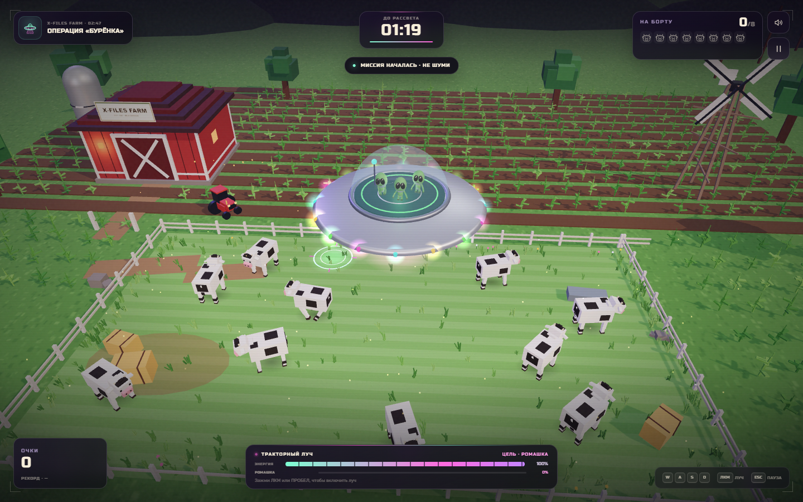
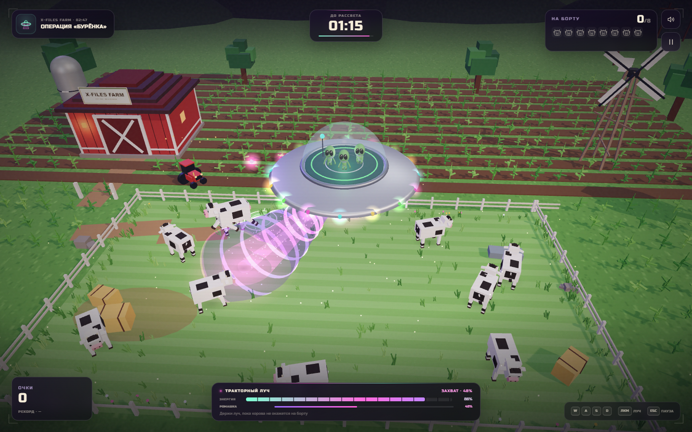

# Операция «Бурёнка»

3D-аркада про похищение коров с воксельной американской фермы. Игрок управляет НЛО, наводит розово-фиолетовый тракторный луч и поднимает коров на борт, пока не рассвело. Внутри тарелки — трое большеголовых серо-зелёных пришельцев в духе Visitors из South Park: огромные чёрные глаза, тонкие тела и уверенность, что «му» — это древний межгалактический язык.





## Запуск

```bash
npm install
npm run dev
```

Игра откроется на `http://127.0.0.1:5173/`.

Сборка:

```bash
npm run build
npm run preview
```

## Геймплей

- Цель — похитить **8 коров за 80 секунд**.
- Тарелка летает над фермой, луч автоматически захватывает ближайшую корову в радиусе.
- Держи луч **1,75 секунды**, чтобы поднять корову. Отпустишь — она начнёт опускаться.
- Энергия луча тратится при захвате. При нуле излучатель перегревается и на время отключается.
- Коровы пугаются и разбегаются, если тарелка подлетает слишком близко.
- Похищения подряд дают комбо до ×5 и больше очков. В конце к счёту прибавляется бонус за оставшееся время.
- Рекорд сохраняется в `localStorage`.

## Управление

| Действие | Клавиши |
| --- | --- |
| Полёт | `WASD` / стрелки |
| Тракторный луч | `ЛКМ` / `Пробел` |
| Пауза | `Esc` |
| Сенсорное управление | Экранные кнопки на мобильных |

## Стек

- **Svelte 5** — интерфейс, HUD, меню, состояния игры.
- **Three.js** — воксельная ферма, коровы, НЛО, пришельцы, луч, частицы и анимации.
- **Vite** — dev-сервер и сборка.
- **Russo One / Rubik** — локальные шрифты из Fontsource.
- Процедурный Web Audio для звуков луча, коров и победы — без внешних ассетов.

## Визуальные детали

- Воксельные коровы с анимацией ходьбы, испуга, жевания и болтающихся ног при подъёме.
- Ферма: амбары, силос, трактор, кукурузное поле, забор, ветряк, стога, светлячки, звёзды и туманность.
- НЛО с металлическим корпусом, стеклянным куполом и тремя пришельцами; анимация парения, крена, иллюминации и реакции экипажа.
- Полупрозрачный объёмный луч с кольцами, частицами и мягким фиолетовым свечением.
- Сцена на стартовом экране сразу показывает похищение: корова уже висит в луче.
- HUD с таймером, квотой, очками, комбо, энергией и процентом захвата.
- Адаптивная вёрстка и сенсорные кнопки для мобильных устройств.

## Проверка

В проекте есть браузерные сценарии Playwright:

```bash
node scripts/verify.mjs
node scripts/visual.mjs
```

Они запускают Chrome, проверяют меню, реальное похищение мышью, движение, паузу, полный рейд на 8 коров, экран победы, экран поражения и мобильное управление. Скриншоты складываются в `artifacts/final/`.
